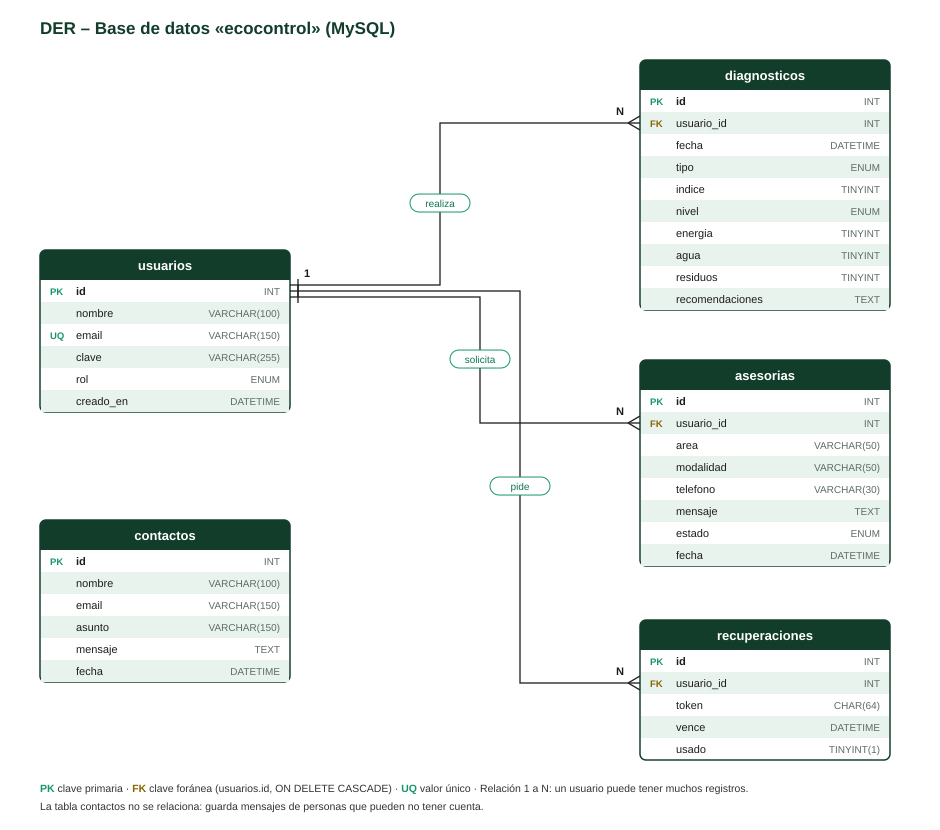

# EcoControl – Base de datos

Base de datos **ecocontrol** en MySQL / MariaDB (XAMPP). Se crea importando [`database/ecocontrol.sql`](../database/ecocontrol.sql) desde phpMyAdmin.

## DER (diagrama entidad-relación)

- **usuarios 1 — N diagnosticos:** un usuario realiza muchos diagnósticos.
- **usuarios 1 — N asesorias:** un usuario solicita muchas asesorías.
- **usuarios 1 — N recuperaciones:** un usuario puede pedir varias veces recuperar su contraseña.
- **contactos** no se relaciona: guarda mensajes de personas que pueden no tener cuenta.
- Las claves foráneas usan `ON DELETE CASCADE`: si se borra un usuario, se borran también sus registros.

## Diccionario de datos

### Tabla `usuarios`

Clientes y Titular que usan el sistema.

| Campo | Tipo | Clave | Descripción |
|---|---|---|---|
| `id` | INT | PK | Identificador único del usuario (autoincremental). |
| `nombre` | VARCHAR(100) | – | Nombre y apellido. |
| `email` | VARCHAR(150) | UQ | Correo electrónico; no se puede repetir. Se usa para iniciar sesión. |
| `clave` | VARCHAR(255) | – | Contraseña encriptada con password_hash() (nunca el texto original). |
| `rol` | ENUM | – | 'cliente' o 'admin' (Titular). Por defecto 'cliente'. |
| `creado_en` | DATETIME | – | Fecha y hora de registro (automática). |

### Tabla `diagnosticos`

Cada diagnóstico ambiental realizado y su Índice Eco.

| Campo | Tipo | Clave | Descripción |
|---|---|---|---|
| `id` | INT | PK | Identificador único del diagnóstico. |
| `usuario_id` | INT | FK | Cliente que hizo el diagnóstico (usuarios.id). |
| `fecha` | DATETIME | – | Fecha y hora del diagnóstico (automática). |
| `tipo` | ENUM | – | 'Hogar' o 'Negocio'. |
| `indice` | TINYINT | – | Índice Eco de 0 a 100 (lo recalcula el servidor). |
| `nivel` | ENUM | – | 'Bajo' (0-39), 'Medio' (40-69) o 'Alto' (70-100). |
| `energia` | TINYINT | – | Puntaje del área energía (0 a 100). |
| `agua` | TINYINT | – | Puntaje del área agua (0 a 100). |
| `residuos` | TINYINT | – | Puntaje del área residuos (0 a 100). |
| `recomendaciones` | TEXT | – | Lista de recomendaciones en formato JSON. |

### Tabla `asesorias`

Solicitudes de asesoramiento de los clientes.

| Campo | Tipo | Clave | Descripción |
|---|---|---|---|
| `id` | INT | PK | Identificador único de la solicitud. |
| `usuario_id` | INT | FK | Cliente que la pidió (usuarios.id). |
| `area` | VARCHAR(50) | – | Energía, Agua, Residuos o Plan de mejora completo. |
| `modalidad` | VARCHAR(50) | – | Videollamada, Visita presencial o Por correo. |
| `telefono` | VARCHAR(30) | – | Teléfono de contacto (opcional, admite NULL). |
| `mensaje` | TEXT | – | Qué necesita el cliente. |
| `estado` | ENUM | – | 'Pendiente', 'En curso' o 'Finalizada'. Lo cambia el Titular. |
| `fecha` | DATETIME | – | Fecha y hora de la solicitud (automática). |

### Tabla `recuperaciones`

Pedidos para crear una contraseña nueva.

| Campo | Tipo | Clave | Descripción |
|---|---|---|---|
| `id` | INT | PK | Identificador único del pedido. |
| `usuario_id` | INT | FK | Usuario que pidió recuperar (usuarios.id). |
| `token` | CHAR(64) | – | Código aleatorio del enlace de recuperación. |
| `vence` | DATETIME | – | Vencimiento: 1 hora después del pedido. |
| `usado` | TINYINT(1) | – | 0 = sin usar, 1 = ya usado (un solo uso). |

### Tabla `contactos`

Mensajes del formulario de contacto (no requieren cuenta).

| Campo | Tipo | Clave | Descripción |
|---|---|---|---|
| `id` | INT | PK | Identificador único del mensaje. |
| `nombre` | VARCHAR(100) | – | Nombre de quien escribe. |
| `email` | VARCHAR(150) | – | Correo para responder. |
| `asunto` | VARCHAR(150) | – | Asunto del mensaje. |
| `mensaje` | TEXT | – | Texto del mensaje. |
| `fecha` | DATETIME | – | Fecha y hora de envío (automática). |

**Claves:** PK = clave primaria · FK = clave foránea · UQ = valor único.
