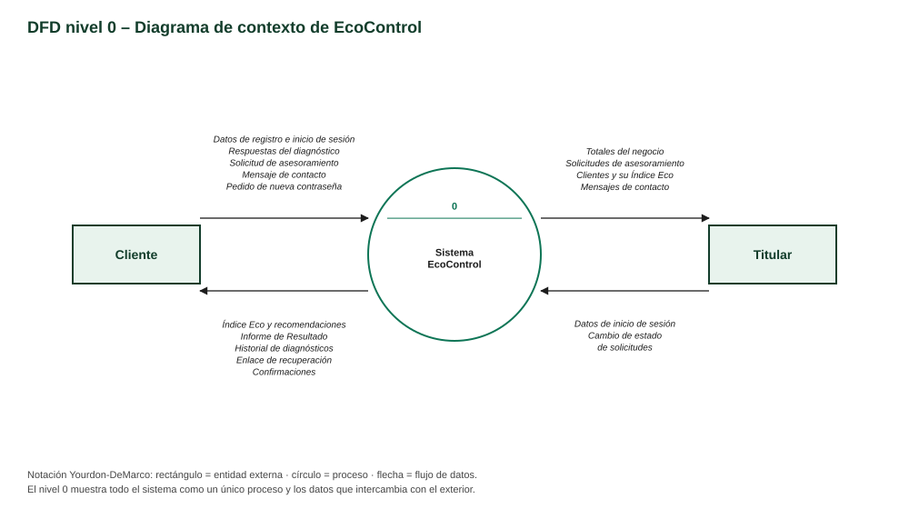
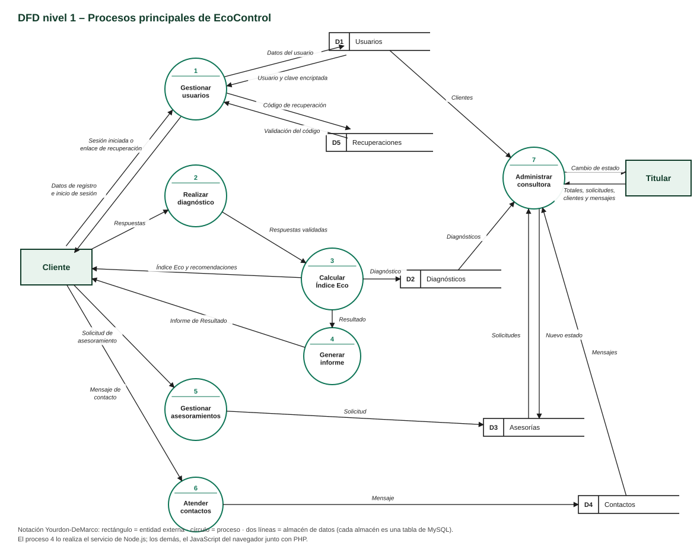

# EcoControl – Diagramas de flujo de datos (DFD)

Notación **Yourdon-DeMarco**: rectángulo = entidad externa · círculo = proceso · dos líneas paralelas = almacén de datos · flecha = flujo de datos.

## Nivel 0 – Diagrama de contexto

Todo el sistema es un único proceso que intercambia datos con el **Cliente** y con el **Titular**.

| Entidad | Datos que envía al sistema | Datos que recibe del sistema |
|---|---|---|
| Cliente | Datos de registro e inicio de sesión, respuestas del diagnóstico, solicitud de asesoramiento, mensaje de contacto, pedido de nueva contraseña | Índice Eco y recomendaciones, Informe de Resultado, historial, enlace de recuperación, confirmaciones |
| Titular | Datos de inicio de sesión, cambio de estado de solicitudes | Totales, solicitudes de asesoramiento, clientes y su Índice Eco, mensajes de contacto |

## Nivel 1 – Procesos principales

| N.º | Proceso | Qué hace | Almacenes | Dónde está programado |
|---|---|---|---|---|
| 1 | Gestionar usuarios | Registra cuentas, inicia y cierra sesión y genera y valida los códigos para recuperar la contraseña. | D1 Usuarios, D5 Recuperaciones | JavaScript + PHP (login, registro, recuperar, nueva_clave) |
| 2 | Realizar diagnóstico | Muestra las preguntas por pasos y controla que estén todas respondidas. | — | JavaScript (app.js) |
| 3 | Calcular Índice Eco | Calcula el puntaje de cada área, el Índice Eco, el nivel y las recomendaciones, y guarda el diagnóstico. | D2 Diagnósticos | JavaScript + PHP (diagnosticos.php) |
| 4 | Generar informe | Arma el Informe de Resultado imprimible y vuelve a calcular el índice para que no se pueda falsear. | — | Node.js (servicio-node) |
| 5 | Gestionar asesoramientos | Recibe la solicitud de asesoramiento del cliente. | D3 Asesorías | JavaScript + PHP (asesoramiento.php) |
| 6 | Atender contactos | Recibe y guarda los mensajes del formulario de contacto. | D4 Contactos | JavaScript + PHP (contacto.php) |
| 7 | Administrar consultora | Muestra al Titular los totales, las solicitudes, los clientes y los mensajes, y cambia el estado de las solicitudes. | D1, D2, D3 y D4 | JavaScript + PHP (admin.php) |

## Almacenes de datos

| Código | Almacén | Tabla de MySQL |
|---|---|---|
| D1 | Usuarios | `usuarios` |
| D2 | Diagnósticos | `diagnosticos` |
| D3 | Asesorías | `asesorias` |
| D4 | Contactos | `contactos` |
| D5 | Recuperaciones | `recuperaciones` |
