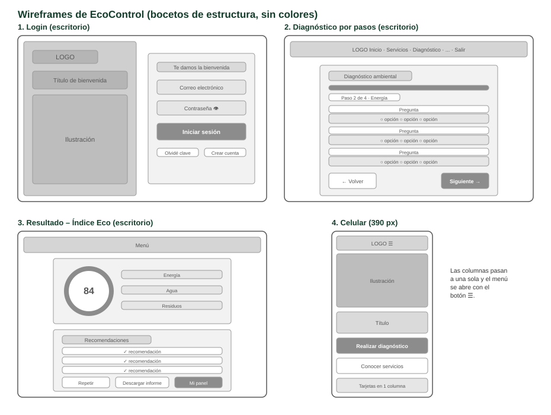
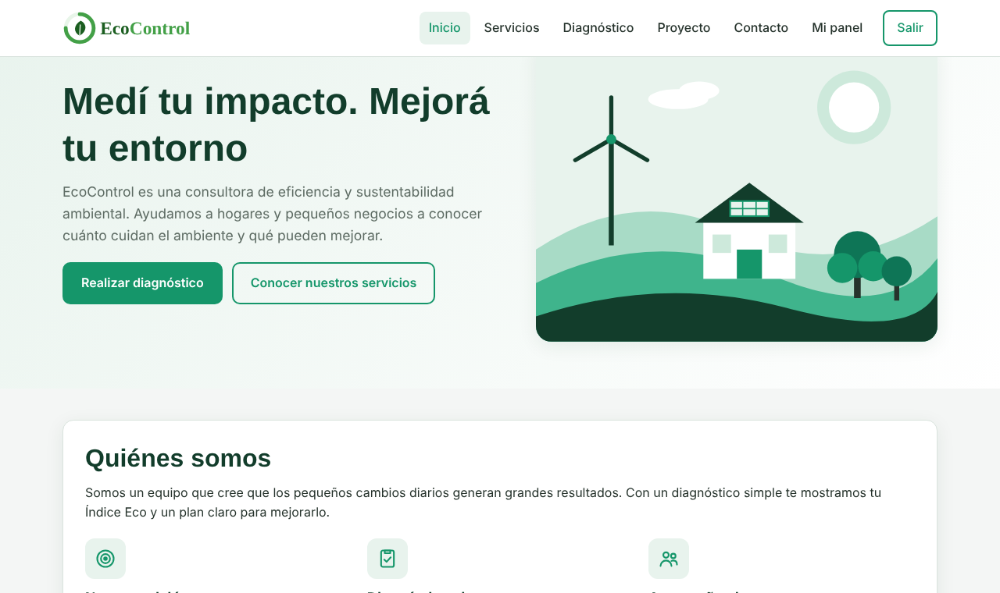
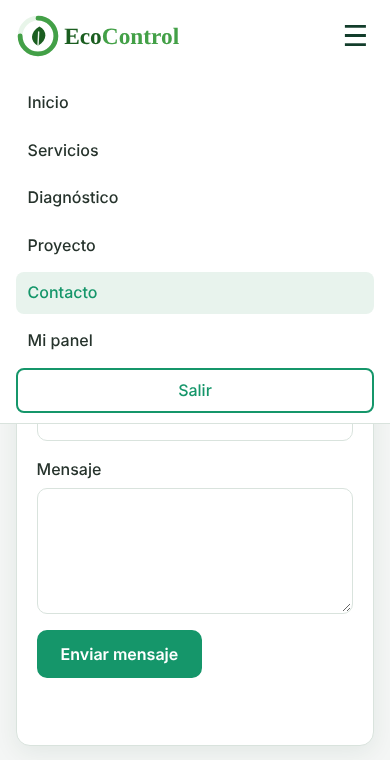

# EcoControl – Diseño UI/UX

El diseño se pensó para que cualquier persona, sin conocimientos técnicos, pueda hacer el diagnóstico en pocos minutos. Primero se hicieron bocetos de estructura (wireframes) sin colores; después se aplicaron la paleta, las tipografías y los íconos.

## Wireframes

## Paleta de colores

Contraste medido según WCAG (mínimo recomendado para texto normal: 4,5:1).

| Color | Nombre | Uso | Contraste |
|---|---|---|---|
| `#123D2B` | Verde oscuro | Títulos, menú activo, pie de página. Transmite confianza y seriedad. | 12,15:1 sobre blanco |
| `#15966A` | Esmeralda | Botones y acentos. Representa la naturaleza y la acción positiva. | 3,75:1: solo en botones con texto grande y en negrita |
| `#0E7556` | Esmeralda oscuro | Enlaces, mensajes de éxito y botones al pasar el mouse. | 5,68:1 sobre blanco |
| `#E8F3ED` | Verde suave | Fondos de íconos, encabezados de tablas y opciones elegidas. | Fondo |
| `#F4F6F5` | Gris claro | Fondo general de la aplicación. | Fondo |
| `#26332C` | Gris oscuro | Texto principal. | 12,15:1 sobre gris claro |
| `#C62828` | Rojo | Mensajes de error y nivel Bajo. | 5,62:1 sobre blanco |

## Tipografías

| Tipografía | Uso | Por qué |
|---|---|---|
| Manrope | Títulos | Geométrica y moderna, da una imagen de empresa tecnológica. |
| Inter | Textos, botones y formularios | Diseñada para pantallas: se lee bien en tamaños chicos y en celulares. |

## Decisiones de experiencia de usuario

- **Diagnóstico en 4 pasos** con barra de progreso, para no mostrar 10 preguntas juntas.
- **Resultado visual:** medidor circular, nivel con color y una barra por área.
- **Mensajes claros** en cada formulario; los campos con error se marcan en rojo.
- **Botón del ojo** para ver la contraseña.
- **Una sola página** para la aplicación, con los botones Atrás y Adelante del navegador funcionando.

## Diseño responsivo

| Ancho de pantalla | Qué cambia |
|---|---|
| Más de 900 px | Diseño completo: login en dos columnas, pestañas a la izquierda. |
| Hasta 1080 px | El menú se esconde detrás del botón ☰ para que todas las opciones entren. |
| Hasta 900 px | El login muestra solo el formulario; el inicio pasa a una columna. |
| Hasta 760 px | Medidor del resultado centrado; tarjetas a todo el ancho. |

## Antes y después (computadora y celular)

| Computadora | Celular |
|---|---|
|  |  |

## Accesibilidad

Todos los campos tienen etiqueta, los botones sin texto tienen `aria-label`, los mensajes usan `role="alert"` y el idioma está declarado en español. Los textos chicos de color verde usan el tono oscuro `#0E7556` para cumplir el contraste mínimo.
